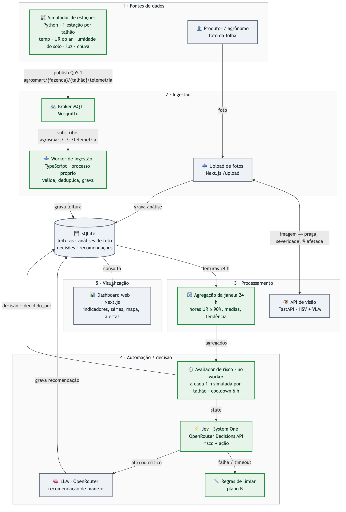
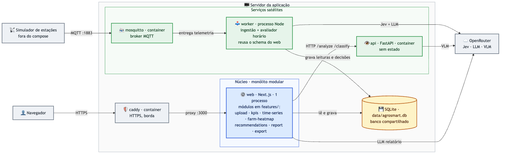

# 1. Arquitetura da Solução — AgroSmart Fase 6

A Fase 6 integra o que foi construído nas fases anteriores (análise de fotos de folhas por visão computacional e IA, banco de análises, dashboard e relatório com IA generativa) a um novo fluxo de **dados do ambiente**: estações simuladas publicam leituras num broker MQTT, um worker grava essas leituras, e uma automação horária decide se o talhão precisa de ação.

Verde = componente novo da Fase 6. Cinza = componente das fases anteriores, reaproveitado ou estendido. Fonte editável: [`01-arquitetura_01_flowchart_fluxo-de-dados.mmd`](diagrams/01-arquitetura_01_flowchart_fluxo-de-dados.mmd) (Mermaid).

## Fluxo de dados

1. **Coleta do ambiente.** Cada talhão tem uma estação simulada que lê, no mesmo instante, temperatura, umidade relativa do ar, umidade do solo e luminosidade, e publica uma mensagem JSON no tópico `agrosmart/{fazenda}/{talhão}/telemetria`.
2. **Coleta de imagens.** O produtor envia a foto da folha pelo app web. A API de visão calcula a área afetada (HSV) e identifica a praga (VLM).
3. **Ingestão.** O worker assina todos os talhões (`agrosmart/+/+/telemetria`), valida o payload, descarta duplicatas pela chave `(talhão, instante)` e grava a leitura no banco.
4. **Processamento.** A cada hora, para cada talhão, as leituras das últimas 24 h viram agregados: temperatura mín./méd./máx., umidade do ar média e máxima, horas com umidade ≥ 90% (substituto do molhamento foliar), umidade do solo e horas com solo ≤ 20%, horas acima de 32 °C, horas de sol forte, tendência em relação às 24 h anteriores e a última análise de foto do talhão.
5. **Automação.** O avaliador envia esses agregados ao **Jev**, um modelo *System One* que devolve decisões tipadas com probabilidade: o nível (baixo, moderado, alto, crítico) de três riscos (doença fúngica, estresse hídrico e estresse térmico) e a ação (nada, notificar, irrigar, sugerir agrônomo, gerar relatório). Risco alto ou crítico, fora do cooldown de 6 h, aciona o LLM para redigir a recomendação de manejo. Se o Jev falhar, regras de limiar decidem. Toda decisão é gravada com quem decidiu (`jev` ou `regra`).
6. **Visualização.** O dashboard mostra os indicadores de fotos (fases anteriores) junto com os indicadores do ambiente, a evolução no tempo e o feed de alertas e recomendações.

## Componentes

| Componente | Camada | Responsabilidade | Tecnologia | Origem |
|---|---|---|---|---|
| Simulador de estações | Fonte de dados | Gera leituras plausíveis por talhão (ciclo dia/noite, microclima, eventos de chuva) e publica no broker; relógio simulado permite histórico e tempo acelerado | Python 3.10+, `paho-mqtt` | **Fase 6** (evolui o simulador da AgroSat) |
| Upload de fotos | Fonte de dados | Recebe a foto da folha, deduplica por hash e registra auditoria | Next.js 16 (`/upload`) | Fases 2 e 4 |
| Broker MQTT | Ingestão | Desacopla quem publica de quem consome (pub/sub), padrão em IoT | Eclipse Mosquitto 2.0.20 | **Fase 6** |
| Worker de ingestão | Ingestão | Assina a telemetria, valida, deduplica e grava; processo próprio, separado do site, para manter a conexão com o broker sempre ativa | TypeScript (Node), reusa o schema Drizzle do app web (`web/scripts/worker.ts`) | **Fase 6** |
| API de visão | Processamento | Calcula % de área afetada por segmentação HSV e classifica a praga com modelo de visão | FastAPI, OpenCV, VLM via OpenRouter | Fases 1 a 3 (HSV nasceu no script da Fase 1) |
| Agregação da janela | Processamento | Resume as últimas 24 h de leituras por talhão em indicadores compactos | TypeScript | **Fase 6** |
| Avaliador de risco | Automação | Roda dentro do worker: na primeira leitura de cada nova hora (relógio da estação) de um talhão, monta o estado, chama o Jev, aplica o cooldown e registra a decisão | TypeScript (`web/src/features/telemetry/`) | **Fase 6** |
| Jev (System One) | Automação | Classifica três riscos (fúngico, hídrico, térmico) e escolhe a ação, com probabilidades, numa só chamada; barato e rápido, decide se vale escalar | `typesafe/jev-1.13` via OpenRouter Decisions API | **Fase 6** |
| Regras de limiar | Automação | Plano B quando o Jev está indisponível (ex.: muitas horas de folha úmida → risco fúngico alto; solo ≤ 20% → risco hídrico alto) | TypeScript | **Fase 6** (evolução da automação por regras) |
| LLM de recomendação | Automação | Redige a recomendação de manejo, sem citar produto nem dose (exige receituário agronômico) | OpenRouter (chat completions) | Fase 5 (estendido) |
| Banco de dados | Armazenamento | Fazendas, talhões, análises de foto, leituras, decisões e recomendações | SQLite (WAL) + Drizzle ORM | Fase 2 (estendido) |
| Dashboard web | Visualização | Indicadores, séries temporais, mapa de calor, alertas e recomendações | Next.js 16, React 19, Recharts | Fase 2 (estendido) |
| Proxy de borda | Infraestrutura | HTTPS e cabeçalhos de segurança; só o app web fica exposto | Caddy 2 | Fase 2 |

## Estilo arquitetural

O AgroSmart segue uma **arquitetura baseada em serviços**: um **núcleo em monólito modular** cercado por **serviços satélites**.

- **Núcleo, o app web.** É um único processo Next.js dividido em módulos por funcionalidade (`web/src/features/`: upload, kpis, time-series, farm-heatmap, recommendations, report, export…). Esses módulos compartilham o acesso ao banco e o schema em `web/src/shared/db/`.
- **Satélites, implantados à parte.** São três:
  - a API de visão: só calcula, não guarda nada;
  - o broker MQTT;
  - o worker de ingestão, que também executa o avaliador horário: grava no mesmo banco reaproveitando o schema do núcleo.
- **Por que não é microsserviços.** Web e worker dividem o mesmo SQLite, em vez de cada serviço ter o próprio banco.

O banco compartilhado mantém os dados consistentes num só lugar e evita duplicar o schema. O custo é acoplar web e worker a mudanças de tabela, o que é aceitável para um sistema mantido por uma equipe só. Fonte editável: [`01-arquitetura_02_flowchart_estilo-implantacao.mmd`](diagrams/01-arquitetura_02_flowchart_estilo-implantacao.mmd).

## Decisões de arquitetura

- **MQTT em vez de HTTP para os sensores.** Com vários dispositivos, o broker isola as estações do sistema: a estação não precisa saber quem consome, e novos consumidores entram sem mudar o simulador.
- **Uma mensagem por estação.** Todas as grandezas do talhão chegam juntas e coerentes no mesmo instante; o worker não precisa remontar a leitura.
- **Instante da leitura vem da estação.** O campo `ts` é o momento da captura no relógio do dispositivo. Isso permite histórico e tempo acelerado sem distorcer as séries.
- **Janela deslizante de 24 h, reavaliada de hora em hora.** Doenças foliares dependem de horas seguidas de folha molhada, não de uma leitura isolada. 24 h cobrem um ciclo dia/noite; avaliar de hora em hora mantém a análise atual com custo baixo.
- **Decisão em camadas.** O Jev, barato e rápido, avalia sempre; o LLM, mais caro, só é chamado quando o risco é alto e fora do cooldown. Regras garantem que a automação funcione mesmo com o serviço externo fora do ar.

## Limites conhecidos

- Broker sem autenticação nem TLS: aceitável na simulação, porque fica na rede interna do Docker e, em desenvolvimento, só em `127.0.0.1`. Em campo, exigiria usuário/senha por estação e TLS.
- Sem autenticação de usuários e com um único cliente (herdado das fases anteriores).
- Umidade do ar alta é usada como substituto do molhamento foliar; num campo real os limiares seriam calibrados com um agrônomo.
