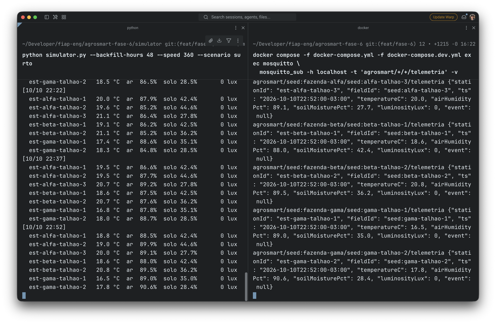

# 2. Coleta de Dados do Ambiente — Simulação de IoT

Os dados do ambiente vêm de **estações simuladas por software** (ferramenta equivalente ao TinkerCad, como nas fases anteriores do projeto). Cada talhão tem uma estação: um conjunto de sensores ligado a um único microcontrolador, que lê todas as grandezas no mesmo instante e envia uma mensagem só, via MQTT.

Código: [`simulator/simulator.py`](../../simulator/simulator.py). Broker: serviço `mosquitto` no `docker-compose.yml`.

## Sensores simulados

| Sensor | Grandeza | Unidade | Faixa observada* | Equivalente real | Comportamento simulado |
|---|---|---|---|---|---|
| Temperatura do ar | `temperatureC` | °C | 10,0 – 32,3 | DHT22 | Ciclo dia/noite (mínima ~3h, máxima ~15h, 16–30 °C); microclima de ±1,5 °C por talhão; deriva lenta; ruído; chuva esfria 3 °C |
| Umidade relativa do ar | `airHumidityPct` | % | 43,3 – 98,9 | DHT22 | Inversa à temperatura: alta de madrugada (orvalho), baixa à tarde; chuva leva a 95–99% |
| Umidade do solo | `soilMoisturePct` | % volumétrica | 25,3 – 38,4 | Sensor capacitivo de solo | Cai com a evaporação (mais rápido no calor) e sobe 1,5 ponto por hora de chuva; limitada a 15–45% |
| Luminosidade | `luminosityLux` | lux | 0 – 83.316 | Luxímetro digital | Zero à noite, pico ao meio-dia (até ~90 mil lux); nebulosidade variável; chuva corta 85% da luz |
| Evento de chuva | `event` | — | `"chuva"` ou `null` | Pluviômetro | Começa ao acaso e dura 1–4 h; afeta todas as grandezas acima |

\* Faixas observadas no exemplo capturado (24 h, 7 talhões, cenário normal).

### Cenários

| Cenário | Diferença | Uso |
|---|---|---|
| `normal` | Chance de chuva de 2% por hora | Operação típica |
| `surto` | Umidade do ar +8 pontos e chance de chuva de 6% por hora | Noites úmidas mais longas, condição que favorece fungos foliares; usado para demonstrar a automação |
| `seca` | Sem chuva, 6 °C mais quente, umidade do ar −20 pontos, solo começando em 19–24% e evaporando 2,5× mais rápido | Solo seco e calor: estresse hídrico e térmico |
| `misto` (padrão da demo) | Cada fazenda numa condição: Alfa em `surto`, Beta em `seca`, Gama `normal` | Os três tipos de risco aparecem ao mesmo tempo no dashboard |

## Contrato da mensagem (MQTT)

- **Tópico:** `agrosmart/{fazenda}/{talhão}/telemetria`, por exemplo `agrosmart/seed:fazenda-alfa/seed:alfa-talhao-1/telemetria`. O consumidor assina `agrosmart/+/+/telemetria` para receber todos os talhões.
- **QoS 1:** o broker garante entrega "pelo menos uma vez". Pode haver duplicata, e o consumidor deduplica pela chave `(fieldId, ts)`.
- **Payload:** uma leitura completa por estação.

```json
{
  "stationId": "est-gama-talhao-2",
  "fieldId": "seed:gama-talhao-2",
  "ts": "2026-10-09T18:28:00-03:00",
  "temperatureC": 24.6,
  "airHumidityPct": 95.8,
  "soilMoisturePct": 30.7,
  "luminosityLux": 0,
  "event": "chuva"
}
```

| Campo | Significado |
|---|---|
| `stationId` | Identificador da estação |
| `fieldId` | Talhão onde a estação está; liga a leitura ao cadastro (`fields`) |
| `ts` | Instante da captura no relógio da estação (ISO 8601 com fuso) |
| `temperatureC`, `airHumidityPct`, `soilMoisturePct`, `luminosityLux` | Leituras dos sensores |
| `event` | Evento ambiental em curso (`"chuva"`) ou `null` |

## Relógio simulado

O instante `ts` vem do simulador, não do servidor. Isso permite:

- **Histórico** (`--backfill-hours`): publica de imediato as últimas N horas, para a análise de 24 h ter dados desde o início.
- **Tempo acelerado** (`--speed`): por exemplo, `--speed 360` faz 1 hora simulada passar em 10 s reais. Útil na demonstração em vídeo.

## Como executar

Para a demonstração completa, use `cd web && bun run demo`: um comando sobe broker, worker, app e simulador. As mensagens chegando aparecem no navegador em `http://localhost:3000/ambiente/leituras`. Os passos abaixo rodam cada peça separadamente.


```bash
# 1. Subir o broker (porta 1883 só em 127.0.0.1)
docker compose -f docker-compose.yml -f docker-compose.dev.yml up -d mosquitto

# 2. Em outro terminal, acompanhar as mensagens chegando no broker
docker compose -f docker-compose.yml -f docker-compose.dev.yml exec mosquitto \
  mosquitto_sub -h localhost -t 'agrosmart/+/+/telemetria' -v

# 3. Rodar o simulador (Python 3.10+)
cd simulator
python -m venv .venv && source .venv/bin/activate && pip install -r requirements.txt
python simulator.py --backfill-hours 48 --speed 360 --scenario misto
```

Opções: `--interval-min` (minutos simulados entre leituras, padrão 15), `--speed` (padrão 60), `--backfill-hours` (padrão 0), `--count` (leituras ao vivo por estação; sem o parâmetro roda até Ctrl+C), `--scenario normal|surto|seca|misto`, `--seed` (dados reproduzíveis), `--broker-host`/`--broker-port` (ou `MQTT_HOST`/`MQTT_PORT`).

## Exemplo de dados gerados

[`exemplo-telemetria.jsonl`](exemplo-telemetria.jsonl): **672 leituras** capturadas do broker com `mosquitto_sub`. São 7 talhões × 96 instantes (24 h, uma leitura a cada 15 min), cenário normal, `--seed 7`. Não há duplicatas. Há 54 leituras sob chuva, em 4 talhões.

Saída do simulador no modo ao vivo, gerada com `python simulator.py --backfill-hours 6 --count 2 --speed 900 --seed 7 --scenario surto` (trecho):

```
Simulador AgroSmart — 7 estações, cenário 'surto'
  broker localhost:1883 | leitura a cada 15 min simulados | velocidade 900x
Backfill: 168 leituras publicadas (até 10/10 16:14)
[10/10 16:14]
  est-alfa-talhao-1   28.3 °C  ar  56.0%  solo 27.9%   25763 lux
  est-alfa-talhao-2   27.6 °C  ar  53.0%  solo 30.7%   33660 lux
  est-alfa-talhao-3   26.1 °C  ar  95.7%  solo 32.1%    5122 lux  [chuva]
  est-beta-talhao-1   28.2 °C  ar  55.8%  solo 27.4%   20835 lux
  est-beta-talhao-2   29.8 °C  ar  54.8%  solo 32.6%   34869 lux
  est-gama-talhao-1   28.6 °C  ar  53.7%  solo 31.3%   40019 lux
  est-gama-talhao-2   29.8 °C  ar  55.6%  solo 33.4%   39496 lux
```

## Captura da simulação



O print mostra os dois lados da coleta ao mesmo tempo:
- **À esquerda**, o simulador roda com `--backfill-hours 48 --speed 360 --scenario surto` e imprime as leituras das 7 estações a cada 15 min simulados. É noite no relógio simulado: luz em 0 lux e umidade do ar subindo para perto de 90%.
- **À direita**, o `mosquitto_sub` assina `agrosmart/+/+/telemetria` e recebe as mesmas leituras no broker, com o tópico e o payload JSON.

## Testes

```bash
cd simulator && pip install pytest && pytest -q
```

Os testes verificam que as leituras ficam em faixas físicas, que não há luz à noite, que o payload segue o contrato e que o cenário `surto` mantém o ar úmido por mais tempo que o `normal`.
