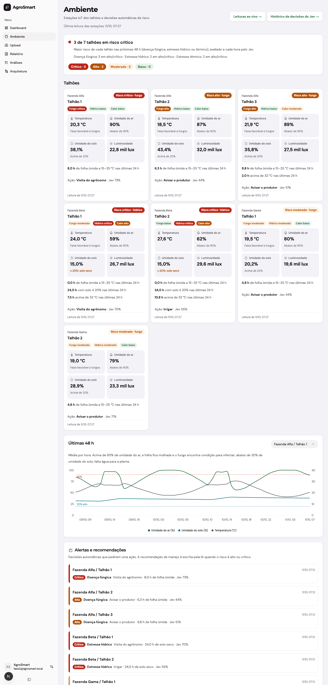
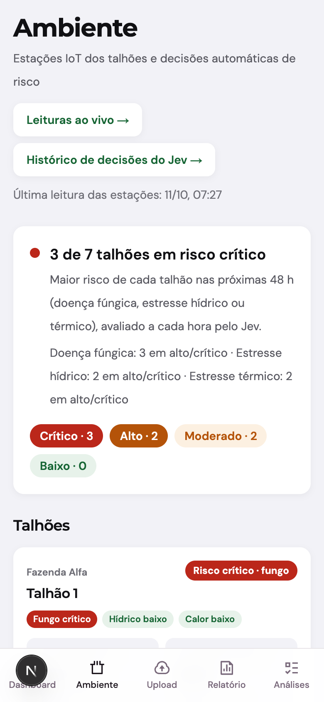
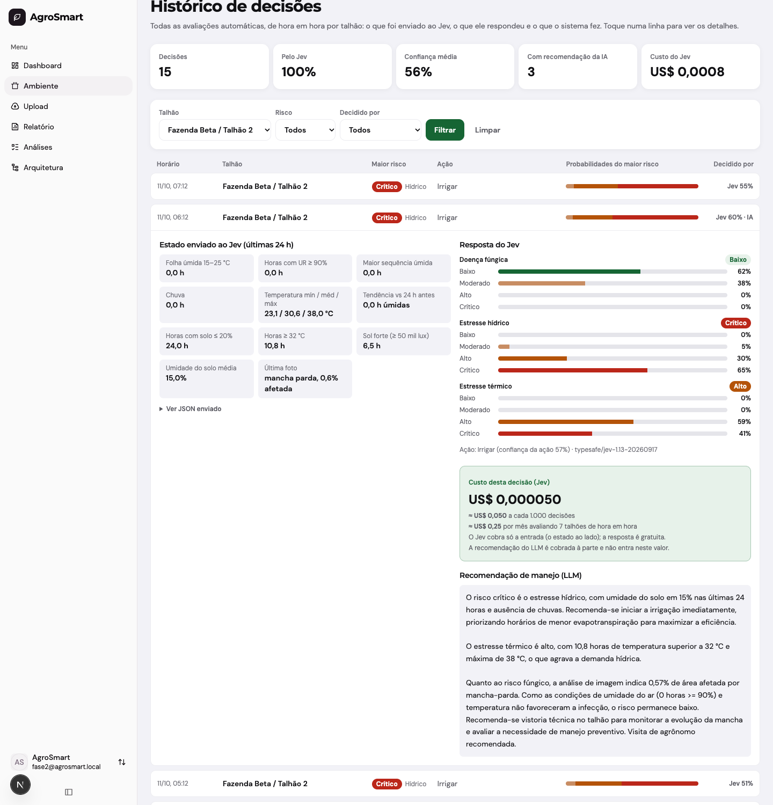
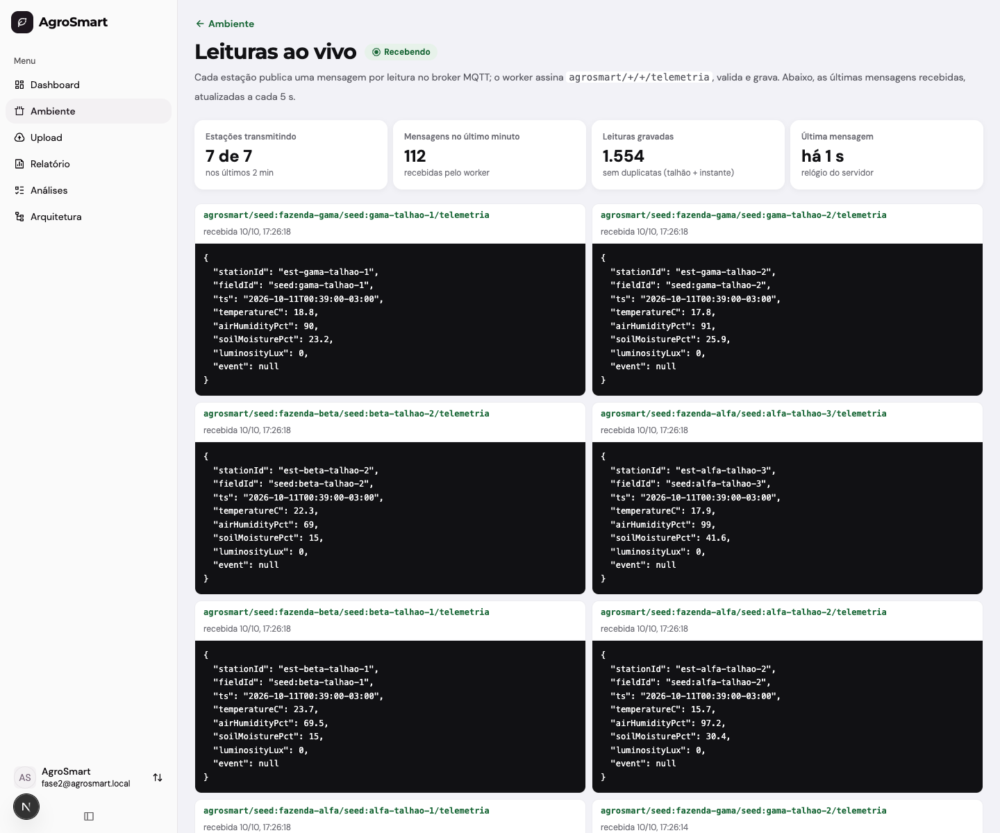

# 5. Dashboard Analítico da Solução

O dashboard **Ambiente** (`/ambiente` no app web) reúne o que as estações medem e o que a automação decidiu. Ele responde em um relance à pergunta do produtor: *"minha lavoura está bem? preciso agir hoje?"*. Fica ao lado das telas das fases anteriores (Dashboard de análises de fotos, Upload, Relatório e Análises), no mesmo app.

- **Ferramenta:** dashboard próprio em Next.js 16 + Recharts, a "ferramenta equivalente" a Power BI ou Tableau. Ele lê direto do mesmo banco que o worker grava, e assim as decisões aparecem sem exportação manual.
- **Atualização:** automática a cada 10 s.
- **Visual:** segue o padrão do app AgroSat: fundo cinza, cartões brancos e **cor apenas para estado** (verde, âmbar, vermelho). Todo número aparece com unidade e contexto.

## Capturas

Desktop:



Celular (primeira tela e página completa: [`dashboard-ambiente-mobile.png`](prints/dashboard-ambiente-mobile.png)):



## Indicadores

| Seção | Indicador | Origem | Como ler |
|---|---|---|---|
| Situação agora | Talhões por nível do **maior risco** (crítico, alto, moderado, baixo), frase-resumo e quantos talhões estão em alto/crítico em cada tipo (fúngico, hídrico, térmico) | Última decisão de cada talhão (`risk_evaluations`) | A cor do ponto segue o pior nível presente; se houver talhão crítico, a frase diz quantos |
| Cartão do talhão | Selo do maior risco e seu tipo (ex.: "Risco crítico · hídrico") e três etiquetas: Fungo, Hídrico e Calor, cada uma com seu nível | Última decisão do Jev (ou das regras) | Verde = baixo, âmbar claro = moderado, âmbar = alto, vermelho = crítico |
| | Temperatura (°C) | Última leitura da estação | Em âmbar quando ≥ 32 °C (estresse por calor); indica "faixa favorável a fungos" entre 15 e 25 °C |
| | Umidade do ar (%) | Última leitura | Em âmbar quando ≥ 90%: folha molhada, condição de infecção |
| | Umidade do solo (%) | Última leitura | Em âmbar quando ≤ 20%: solo seco |
| | Luminosidade (mil lux) | Última leitura | "Noite" quando zero |
| | Horas de folha úmida a 15–25 °C, horas com solo ≤ 20% e horas acima de 32 °C nas últimas 24 h | Agregados da janela (`favorableWetHours`, `drySoilHours`, `hotHours`) | Principal sinal de cada tipo de risco |
| | Ação e confiança | Decisão automática (`action`, `risk_confidence`) | O que o sistema decidiu fazer e com quanta certeza o Jev classificou o risco |
| | Chovendo | Evento da última leitura | Chuva espalha esporos |
| Últimas 48 h | Umidade do ar, umidade do solo e temperatura, média por hora, com referências em 90% (folha molhada) e 20% (solo seco) | `sensor_readings` | Mostra as noites de molhamento (fungo) ou o solo secando (hídrico) que levaram ao risco |
| Alertas e recomendações | Decisões com ação diferente de "sem ação": talhão, horário, maior risco e seu tipo, ação (inclusive "Irrigar"), horas do indicador correspondente, confiança | `risk_evaluations` | Feed das ações automáticas, do mais recente para o mais antigo |
| | Recomendação de manejo | Texto do LLM gravado na decisão | Só aparece em risco alto ou crítico (respeitando o cooldown); sem produto nem dose. A mais recente vem aberta |

## Telas de transparência

Para que cada etapa possa ser verificada no navegador, sem terminal, o app tem mais três telas ligadas ao dashboard:

| Tela | O que mostra | Etapa que comprova |
|---|---|---|
| **Leituras ao vivo** (`/ambiente/leituras`) | Cada mensagem MQTT recebida: tópico, JSON da estação e hora de chegada. No topo: estações transmitindo, mensagens no último minuto, leituras gravadas e há quanto tempo chegou a última. Atualiza a cada 5 s | Coleta e ingestão |
| **Histórico de decisões** (`/ambiente/decisoes`) | Todas as avaliações, com filtros por talhão, risco e quem decidiu, paginadas de 30 em 30. Cada linha traz a barra de probabilidades do Jev, com o valor de cada nível no tooltip. Ao abrir uma linha aparecem: o estado enviado ao Jev (agregados das 24 h e última foto, mais o JSON bruto); a resposta com a probabilidade de cada nível; o **custo da decisão** num cartão próprio, com projeção por 1.000 decisões e por mês; e a recomendação do LLM | Processamento e automação |
| **Arquitetura** (`/arquitetura`) | As cinco camadas, os diagramas de fluxo e de implantação e a tabela de componentes | Arquitetura |





## Código

| Arquivo | Papel |
|---|---|
| [`web/src/app/ambiente/page.tsx`](../../web/src/app/ambiente/page.tsx) | Página e atualização automática |
| [`web/src/shared/db/queries/environment.ts`](../../web/src/shared/db/queries/environment.ts) | Consultas: situação por talhão, série de 48 h e alertas |
| [`web/src/features/environment/`](../../web/src/features/environment/) | Componentes: resumo, cartão do talhão, gráfico e feed de alertas |
| [`web/src/app/ambiente/leituras/page.tsx`](../../web/src/app/ambiente/leituras/page.tsx) | Leituras ao vivo |
| [`web/src/app/ambiente/decisoes/page.tsx`](../../web/src/app/ambiente/decisoes/page.tsx) | Histórico de decisões |
| [`web/src/app/arquitetura/page.tsx`](../../web/src/app/arquitetura/page.tsx) | Página de arquitetura |

O "agora" do dashboard é o instante da última leitura recebida, não o relógio do servidor. Assim, a demonstração com tempo acelerado mostra as 48 h corretas.

## Como abrir

Um comando sobe tudo (broker, banco, worker, app e simulador) e abre o navegador:

```bash
cd web && bun run demo      # Ctrl+C encerra
```

Ajustes opcionais por variável de ambiente: `SPEED=120` (1 hora simulada a cada 30 s), `SCENARIO=surto|normal`, `BACKFILL_HOURS=48`, `RESET=1` (limpa leituras e decisões anteriores). Os logs ficam em `data/demo-logs/`.
