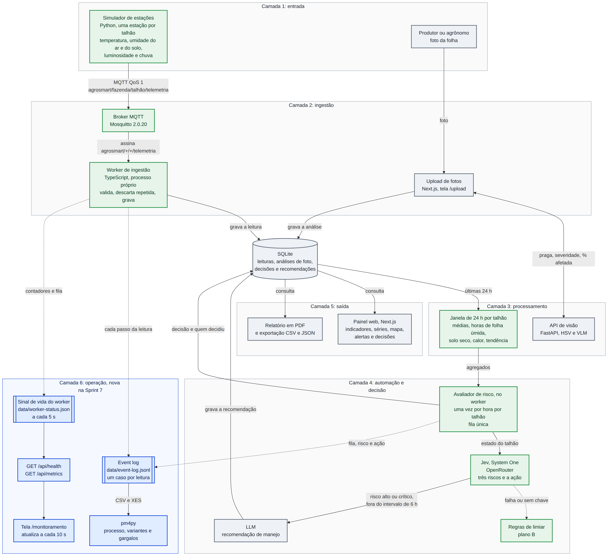
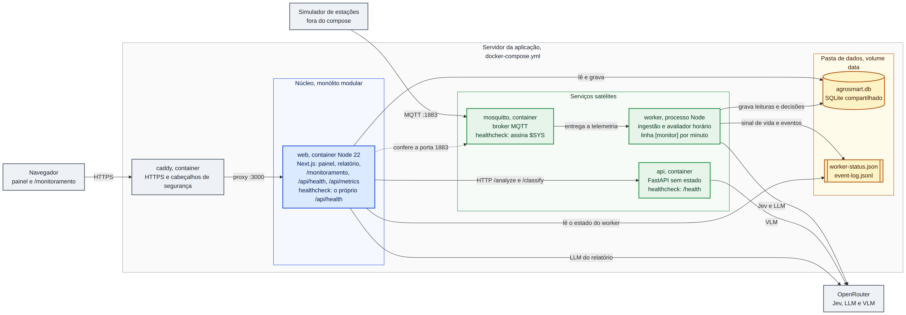
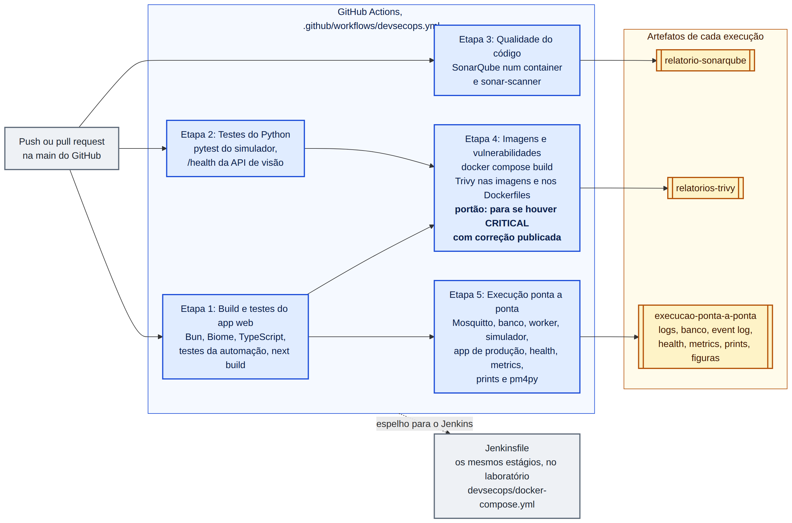

# 1. Arquitetura final

A plataforma da Sprint 6 continua a mesma no centro: estações simuladas publicam leituras num broker MQTT, um worker grava e avalia cada talhão de hora em hora, e o painel mostra as decisões. A Sprint 7 acrescenta uma **sexta camada, a de operação**: o pipeline DevSecOps que prova cada versão, o monitoramento que diz se o sistema está de pé e o event log que permite estudar o processo com mineração de processos.

## Diagrama final



Azul: novo na Sprint 7. Verde: criado na Sprint 6. Cinza: fases anteriores, reaproveitado ou estendido. Fonte editável: [`diagrams/01-fluxo-final.mmd`](diagrams/01-fluxo-final.mmd) (Mermaid); as imagens se geram com [`diagrams/renderizar.sh`](diagrams/renderizar.sh).

## Fluxo de dados: entrada, processamento e saída

**Entrada**

1. **Leitura do ambiente.** Cada talhão tem uma estação simulada que mede, no mesmo instante, temperatura, umidade do ar, umidade do solo e luminosidade, e marca a chuva. A cada 15 minutos simulados ela publica uma mensagem JSON no tópico `agrosmart/{fazenda}/{talhão}/telemetria`, com QoS 1.
2. **Foto da folha.** O produtor envia a foto pela tela `/upload`. A API de visão mede a área afetada (segmentação HSV) e identifica a praga (modelo de visão).

**Processamento**

3. **Ingestão.** O worker assina todos os talhões (`agrosmart/+/+/telemetria`), valida a mensagem, descarta a leitura repetida pela chave (talhão, instante) e grava no banco. Cada passo vira uma linha no event log.
4. **Janela de 24 horas.** Na primeira leitura ao vivo de cada nova hora, o talhão entra na fila do avaliador. As leituras das últimas 24 horas viram agregados: temperatura mínima, média e máxima, umidade do ar, horas de folha úmida, horas de solo seco, horas de calor, tendência e a última análise de foto do talhão.
5. **Decisão.** O avaliador manda os agregados ao Jev, que devolve o nível de três riscos (doença fúngica, falta de água e calor) e a ação (nenhuma, avisar o produtor, irrigar, chamar o agrônomo ou gerar relatório). Se o Jev falhar ou não houver chave, as regras de limiar decidem (plano B). Com risco alto ou crítico, fora do intervalo de 6 horas, um LLM escreve a recomendação de manejo. A decisão é gravada com quem decidiu.

**Saída**

6. **Painel.** O painel web mostra os indicadores das fotos e do ambiente, as séries no tempo, o mapa de calor, as leituras chegando e o histórico de decisões. Também gera o relatório em PDF e exporta CSV e JSON.
7. **Operação.** O worker grava o próprio estado a cada 5 segundos; o `/api/health`, o `/api/metrics` e a tela `/monitoramento` leem esse estado e o banco. O event log vira CSV e XES e o pm4py desenha o processo real.

### Exemplo de entrada e saída (execução do pipeline)

Tirado da [execução 44963951873](https://github.com/Dsfr62/fiap-agrosmart-sprint7/actions/runs/44963951873) (artefato `execucao-ponta-a-ponta`). Os sensores são simulados; o caminho e os tempos são reais.

**Entrada**, uma mensagem no tópico `agrosmart/seed:fazenda-gama/seed:gama-talhao-2/telemetria`:

```json
{
  "station_id": "est-gama-talhao-2",
  "ts": 1795347540000,
  "temperature_c": 23.5,
  "air_humidity_pct": 73.0,
  "soil_moisture_pct": 31.5,
  "luminosity_lux": 36649,
  "event": null
}
```

**Saída**, uma decisão gravada para a Fazenda Beta, Talhão 1, depois de 24 horas de solo seco:

| Campo | Valor |
|---|---|
| Janela avaliada | 24 horas, 96 leituras |
| Temperatura | mínima 22,2 °C, média 29,7 °C, máxima 36,7 °C (9,8 horas acima de 32 °C) |
| Umidade do solo | média 15,4%, última 15%, 24 horas abaixo de 20% |
| Última foto do talhão | mancha parda, 27,59% da folha afetada |
| Riscos | doença fúngica **baixo**, falta de água **crítico**, calor **crítico** |
| Ação | **irrigar** |
| Quem decidiu | regras de limiar (plano B: o pipeline não tem a chave da OpenRouter) |

A mesma decisão no log do worker:

```text
[21/11, 21:09] Fazenda Beta / Talhão 1 fungo baixo · hídrico CRÍTICO · calor CRÍTICO · ação irrigate · por rule (plano B: Jev respondeu HTTP 401)
```

Nessa execução, 1.008 leituras de 7 talhões viraram 84 decisões, e o `/api/health` respondeu `ok` nos cinco componentes.

## Componentes

| Componente | Camada | Responsabilidade | Tecnologia | Origem |
|---|---|---|---|---|
| Simulador de estações | Entrada | gera leituras plausíveis por talhão (dia e noite, microclima, chuva), com relógio simulado para histórico e tempo acelerado | Python 3.10+, `paho-mqtt` | Sprint 6 |
| Upload de fotos | Entrada | recebe a foto, descarta a repetida pelo hash e registra a auditoria | Next.js, tela `/upload` | fases 2 e 4 |
| Broker MQTT | Ingestão | separa quem publica de quem consome (publicação e assinatura) | Eclipse Mosquitto 2.0.20 | Sprint 6 |
| Worker de ingestão | Ingestão | assina a telemetria, valida, descarta repetida e grava; processo próprio, para a conexão com o broker não depender do site | TypeScript (Node), schema Drizzle do app | Sprint 6 |
| API de visão | Processamento | mede a área afetada (HSV) e classifica a praga | FastAPI, OpenCV, modelo de visão pela OpenRouter | fases 1 a 3 |
| Janela de 24 horas | Processamento | resume as leituras do talhão em indicadores | TypeScript | Sprint 6 |
| Avaliador de risco | Automação | roda dentro do worker; põe o talhão na fila uma vez por hora, monta o estado, chama o Jev e grava a decisão | TypeScript (`web/src/features/telemetry/`) | Sprint 6 |
| Jev (System One) | Automação | classifica os três riscos e escolhe a ação numa chamada só, com probabilidades | `typesafe/jev-1.13` pela OpenRouter | Sprint 6 |
| Regras de limiar | Automação | plano B quando o Jev não responde | TypeScript | Sprint 6 |
| LLM de recomendação | Automação | escreve a recomendação de manejo, sem citar produto nem dose | OpenRouter | fase 5, estendido |
| Banco de dados | Armazenamento | fazendas, talhões, fotos, leituras, decisões e recomendações | SQLite (WAL), Drizzle ORM | fase 2, estendido |
| Painel web | Saída | indicadores, séries, mapa de calor, alertas, decisões, relatório e exportação | Next.js 16, React 19, Recharts | fase 2, estendido |
| Proxy de borda | Infraestrutura | HTTPS e cabeçalhos de segurança; só o app web fica exposto | Caddy 2 | fase 2 |
| **Event log** | Operação | um evento por passo de cada leitura (caso, atividade, instante, recurso e atributos) | JSONL gravado pelo worker | **Sprint 7** |
| **Sinal de vida do worker** | Operação | estado do worker a cada 5 s (broker, mensagens, leituras, fila, erros, tempo médio da avaliação) e uma linha `[monitor]` por minuto no log | JSON ao lado do banco | **Sprint 7** |
| **`/api/health` e `/api/metrics`** | Operação | estado de cada peça (banco, broker, worker, leituras, decisões) e os indicadores em JSON | rotas do Next.js | **Sprint 7** |
| **Tela de monitoramento** | Operação | o mesmo estado e os últimos eventos, atualizando a cada 10 s | Next.js, tela `/monitoramento` | **Sprint 7** |
| **Mineração de processos** | Operação | converte o event log em CSV e XES, descobre o processo, mede conformidade, variantes e gargalos | Python, pm4py, pandas, Graphviz | **Sprint 7** |
| **Pipeline DevSecOps** | Operação | build, testes, qualidade, imagens, vulnerabilidades e execução ponta a ponta a cada push | GitHub Actions; o mesmo no Jenkinsfile | **Sprint 7** |
| **Análise de qualidade** | Operação | Quality Gate, bugs, vulnerabilidades e pontos sensíveis | SonarQube 10.6 e sonar-scanner, em container | **Sprint 7** |
| **Análise de vulnerabilidades** | Operação | procura vulnerabilidades nas imagens e erro de configuração nos Dockerfiles; para o pipeline com CRITICAL que já tem correção | Trivy 0.62 | **Sprint 7** |

## Integração entre os serviços

| De | Para | Como | O que passa |
|---|---|---|---|
| Simulador | Broker | MQTT na porta 1883, QoS 1 | uma mensagem JSON por estação a cada 15 minutos simulados |
| Broker | Worker | assinatura `agrosmart/+/+/telemetria` | a mesma mensagem, para todos os talhões |
| Worker | Banco | Drizzle sobre SQLite | leitura, decisão e recomendação |
| Worker | OpenRouter | HTTPS | estado do talhão ao Jev; pedido de recomendação ao LLM |
| App web | API de visão | HTTP `/analyze` e `/classify` | a foto; volta praga, severidade e área afetada |
| App web | Banco | Drizzle sobre SQLite | consultas do painel, análises de foto |
| Worker | App web | arquivos na pasta do banco | `worker-status.json` (sinal de vida) e `event-log.jsonl` (eventos) |
| App web | Broker | conexão TCP na porta 1883, até 1 s | só para saber se o broker está de pé |
| Navegador | App web | HTTPS pelo Caddy | telas do painel e do monitoramento |
| Ferramenta externa | App web | `GET /api/health` e `GET /api/metrics` | o estado e os indicadores em JSON |

O worker e o app web não se chamam diretamente: dividem o banco e a pasta de dados. Assim um pode reiniciar sem derrubar o outro.

## Implantação e monitoramento



Fonte editável: [`diagrams/02-implantacao-e-monitoramento.mmd`](diagrams/02-implantacao-e-monitoramento.mmd).

- **Containers** (`docker-compose.yml`): web, API de visão, Mosquitto e Caddy. Cada um tem healthcheck: a web chama o próprio `/api/health`, a API responde ao `/health` e o Mosquitto precisa responder a uma assinatura.
- **Worker**: processo Node à parte, que grava no mesmo banco e, ao lado dele, o sinal de vida e o event log.
- **Como o estado é julgado**: banco que não responde deixa o sistema **fora** (`/api/health` devolve 503); broker sem conexão, worker sem sinal há mais de 30 s, leituras paradas há mais de 15 min ou decisões paradas há mais de 2 h deixam o sistema **degradado**. Só o banco derruba o app, para o healthcheck não reiniciar a web porque outra peça parou. Detalhe em [`04-monitoramento.md`](04-monitoramento.md).

## Pipeline DevSecOps



Fonte editável: [`diagrams/03-pipeline-devsecops.mmd`](diagrams/03-pipeline-devsecops.mmd).

A cada push na `main`, as etapas 1, 2 e 3 começam juntas; a 4 (imagens e Trivy) espera a 1 e a 2; a 5 (execução ponta a ponta) espera a 1. O pipeline para se aparecer vulnerabilidade CRITICAL que já tenha correção publicada. O resultado medido e os prints estão em [`03-pipeline.md`](03-pipeline.md).

## Estilo arquitetural

Arquitetura baseada em serviços: um **núcleo em monólito modular** (o app web, com um módulo por funcionalidade em `web/src/features/`) cercado por **serviços satélites** (API de visão, broker MQTT e worker). Não é microsserviços, porque web e worker dividem o mesmo banco. Isso mantém os dados num lugar só e evita duplicar o schema; o custo é acoplar os dois às mudanças de tabela, aceitável para um sistema mantido por uma equipe só. A Sprint 7 seguiu o mesmo estilo: o monitoramento virou um módulo do núcleo (`web/src/features/monitoring/`), e não um serviço novo.

## Decisões de arquitetura da Sprint 7

- **Pipeline no GitHub Actions, com o mesmo pipeline no Jenkinsfile.** O código já vive no GitHub, e o Actions roda a cada push sem servidor para manter. O capítulo 10 ensina com Jenkins, então o [`Jenkinsfile`](../../Jenkinsfile) repete os estágios e o laboratório sobe com [`devsecops/docker-compose.yml`](../../devsecops/docker-compose.yml).
- **SonarQube num container dentro do job.** Sem servidor fixo e sem segredo guardado: a senha e a chave nascem no job e morrem com ele.
- **Portão do Trivy só para CRITICAL com correção publicada.** Bloquear o que ainda não tem correção pararia o pipeline sem nenhuma ação possível; o que sobra aparece no relatório.
- **Monitoramento dentro do próprio app.** O `/api/health` e o `/api/metrics` respondem em JSON, prontos para uma ferramenta de fora ler. Prometheus e Grafana ficaram de fora porque não fazem parte do conteúdo da fase.
- **Sinal de vida por arquivo, ao lado do banco.** Web e worker já dividem a pasta de dados; o arquivo evita abrir porta ou criar serviço novo. A escrita é atômica (arquivo temporário e troca), para a web nunca ler pela metade.
- **Event log gravado pelo próprio sistema.** O worker escreve cada passo no formato que o pm4py pede (caso, atividade, instante, recurso). O caso é uma leitura de sensor, que é o que atravessa o sistema de ponta a ponta.

## Limites conhecidos

- **Sensores simulados.** Não há estação física nem validação com produtor ou agrônomo; os limiares vêm de literatura.
- **Broker sem autenticação nem TLS.** Aceitável na simulação, porque fica na rede interna do Docker; em campo, cada estação precisaria de usuário, senha e TLS.
- **Sem login de usuário e com um único cliente**, herdado das fases anteriores.
- **O worker fica fora do `docker-compose.yml`.** Na demonstração e no pipeline ele roda como processo ao lado do app. Para produção, ele viraria um serviço do compose montando o mesmo volume `data`, para o monitoramento continuar lendo o sinal de vida.
- **Fila única do avaliador.** É o gargalo medido na análise de processo: uma avaliação leva 32 ms e espera 117 ms na fila ([`05-processo.md`](05-processo.md)).
- **Em aberto no pipeline:** 3 vulnerabilidades HIGH do Starlette (pedem atualizar o FastAPI) e 4 pontos sensíveis de expressões regulares apontados pelo SonarQube.
