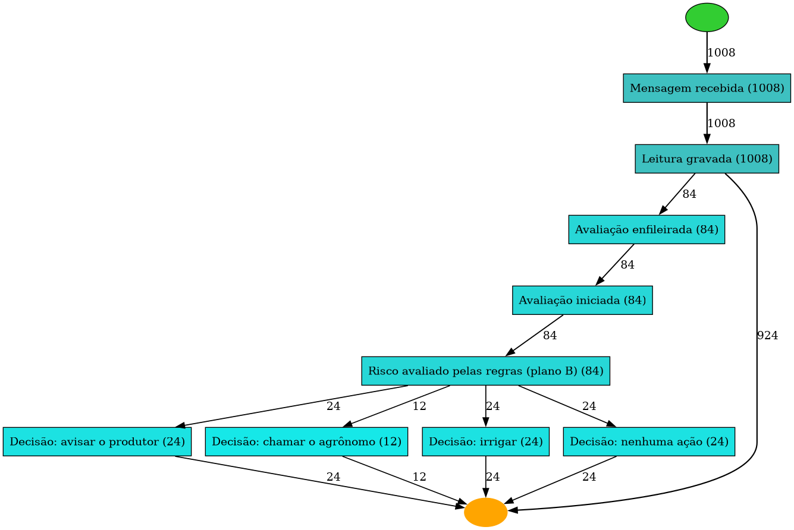
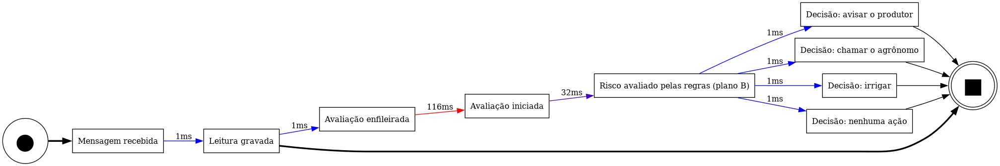

# 5. Análise de processo (mineração de processos)

A plataforma registra por onde cada leitura de sensor passa. Esse registro é o **event log**: com ele, a mineração de processos (capítulo 9 da fase 7, com o **pm4py**) descobre o fluxo real do sistema, mede onde ele espera e mostra os caminhos diferentes que uma leitura pode seguir.

Os números abaixo são da execução ponta a ponta do pipeline de 21/11/2026 ([execução](https://github.com/Dsfr62/fiap-agrosmart-sprint7/actions/runs/44963438354)): 7 talhões simulados, 24 horas de histórico e 12 horas ao vivo, aceleradas. **Os sensores são simulados**; o tempo de cada passo é medido de verdade, no próprio worker.

## O event log

O worker grava um evento a cada passo, em `data/event-log.jsonl` ([código](../../web/scripts/worker.ts)). O script [`processo/exportar_event_log.py`](../../processo/exportar_event_log.py) transforma em CSV e XES.

| Campo | O que é | Exemplo |
|---|---|---|
| `case_id` (caso) | uma leitura: o talhão e o instante da leitura | `seed:alfa-talhao-1@2026-11-20T23:47:00.000Z` |
| `atividade` | o passo que a leitura cumpriu | `Leitura gravada` |
| `instante` | quando o passo aconteceu, em milissegundos | `2026-11-21 23:47:45.974` |
| `recurso` | quem executou o passo | `broker MQTT`, `banco`, `avaliador`, `regras`, `Jev`, `LLM` |
| atributos | talhão, origem (histórico ou ao vivo), fila, riscos e ação | `origem = historico` |

As atividades possíveis:

| Atividade | Recurso | Quando acontece |
|---|---|---|
| Mensagem recebida | broker MQTT | toda mensagem que chega |
| Mensagem descartada (inválida) | worker | a mensagem não passa na validação |
| Leitura gravada | banco | a leitura entra no banco |
| Leitura repetida (ignorada) | banco | a mesma leitura chega de novo |
| Avaliação enfileirada | avaliador | a primeira leitura ao vivo de uma nova hora do talhão |
| Avaliação iniciada | avaliador | o avaliador pega a avaliação da fila |
| Risco avaliado pelo Jev ou pelas regras (plano B) | Jev ou regras | o risco fúngico, hídrico e térmico sai |
| Decisão: nenhuma ação, avisar o produtor, irrigar, chamar o agrônomo ou gerar relatório | avaliador | a ação escolhida |
| Recomendação escrita pela IA | LLM | risco alto, fora do intervalo de 6 h |

Exemplo do log, com até 3 casos de cada caminho: [`processo/exemplo-event-log.csv`](processo/exemplo-event-log.csv).

## O processo descoberto

**2.352 eventos, 1.008 casos e 9 atividades.** O Heuristics Miner (`pm4py.discover_heuristics_net`) desenhou este fluxo; o número em cada caixa é quantas vezes a atividade aconteceu:



A mesma descoberta em rede de Petri ([figura](processo/rede-de-petri.png)) e a **conformidade por token replay** (`pm4py.fitness_token_based_replay`): **fitness 1,0**, com **100% dos casos** cabendo no modelo. Nesta execução, nenhum caso saiu do caminho previsto.

## Variantes: os caminhos que uma leitura percorre

| Casos | % | Mediana do caso | Caminho |
|---:|---:|---:|---|
| 924 | 91,7% | 1 ms | Mensagem recebida → Leitura gravada |
| 24 | 2,4% | 84 ms | ... → Avaliação enfileirada → Avaliação iniciada → Risco avaliado pelas regras → Decisão: avisar o produtor |
| 24 | 2,4% | 154 ms | ... → Risco avaliado pelas regras → Decisão: irrigar |
| 24 | 2,4% | 193 ms | ... → Risco avaliado pelas regras → Decisão: nenhuma ação |
| 12 | 1,2% | 60 ms | ... → Risco avaliado pelas regras → Decisão: chamar o agrônomo |

Só **84 leituras (8,3%)** dispararam uma avaliação: o sistema avalia cada talhão uma vez por hora, com a janela das últimas 24 horas, e o histórico só é gravado.

## Onde o processo espera (gargalos)

O mapa de desempenho (`pm4py.discover_performance_dfg`) pinta de vermelho a transição mais lenta:



| De | Para | Vezes | Média | p95 |
|---|---|---:|---:|---:|
| Avaliação enfileirada | Avaliação iniciada | 84 | **117 ms** | 302 ms |
| Avaliação iniciada | Risco avaliado pelas regras | 84 | 32 ms | 75 ms |
| Mensagem recebida | Leitura gravada | 1.008 | 1 ms | 1 ms |

**O gargalo é a fila do avaliador, não a avaliação.** Uma avaliação leva 32 ms, mas espera 117 ms na fila (3,6 vezes mais), com até 6 avaliações esperando juntas. As avaliações correm uma de cada vez, e os 7 talhões viram a hora no mesmo instante: o sétimo espera os seis antes dele.

## Primeiras leituras e melhorias (base para a análise do grupo)

1. **Fila por talhão ou uma chamada só.** Hoje a fila é única. Avaliar os talhões em paralelo, ou mandar os 7 talhões numa chamada só ao Jev, tira a espera. Pesa mais com o Jev ligado: ele responde pela rede, em centenas de milissegundos, e a espera do sétimo talhão cresce na mesma proporção.
2. **Avaliar antes quando um limite crítico é cruzado.** Como 91,7% das leituras só são gravadas, uma mudança brusca (solo abaixo de 20%, por exemplo) pode esperar até a próxima hora para virar decisão. Uma leitura que cruza um limite crítico poderia disparar a avaliação na hora.
3. **Acompanhar o plano B.** Nesta execução, 100% das decisões saíram pelas regras, porque o pipeline não tem a chave da OpenRouter. Em produção, a taxa de plano B (já no `/api/metrics`) diz quando o Jev está fora.
4. **Testar os desvios.** O log prevê leitura repetida, mensagem inválida e erro na avaliação, mas nenhum apareceu. Um cenário com falhas injetadas mostraria se a conformidade continua alta quando a rede falha.

## Análise do grupo

A completar pela Marina: a leitura dos números acima (gargalos, variações e oportunidades de melhoria), com o pm4py no event log completo (`event-log.csv` e `event-log.xes` no artefato `execucao-ponta-a-ponta` de cada execução do pipeline).

## Como reproduzir

```bash
# depois de rodar a demo (bun run demo), na raiz do repositório:
python3 -m venv .venv && . .venv/bin/activate
pip install -r processo/requirements.txt      # pm4py e pandas; as figuras pedem o Graphviz instalado
python processo/exportar_event_log.py data/event-log.jsonl --saida processo/saida
python processo/analisar_processo.py processo/saida/event-log.csv --saida processo/saida
```
